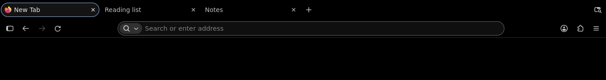
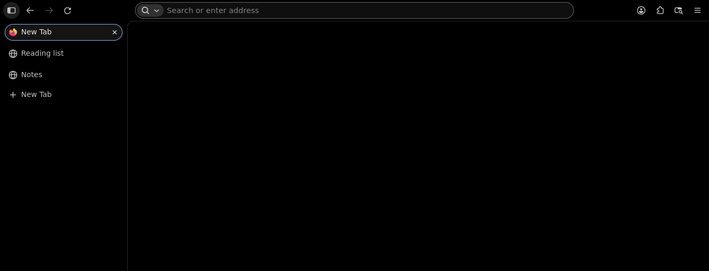

# Adwaita AMOLED

A black Firefox theme with soft blue accents, based on the default palette of
[Adwaita AMOLED](https://github.com/librerob/adwaita-amoled).

The frame stays black. The current tab has a raised surface and a pale blue
outline. Menus and the address bar use small steps in brightness to keep the
controls distinct. Firefox keeps its own Nova layout, spacing and shapes.



<details>
<summary>Vertical tabs</summary>



</details>

Browser chrome captured in Firefox 159.0.1 on Linux. Page content is omitted.

## Try it

The [release archives](https://github.com/librerob/adwaita-amoled-firefox/releases)
are unsigned packages for Mozilla Add-ons submission or temporary testing.

1. Download this repository with **Code → Download ZIP**, then extract it.
2. Open `about:debugging#/runtime/this-firefox` in Firefox 159.0.1 or later.
3. Choose **Load Temporary Add-on** and select `theme/manifest.json`.

The theme lasts until Firefox restarts. Switch themes in `about:addons` to remove
it sooner. No profile edits or custom stylesheets are needed.

## Color choices

The palette uses two blues for different jobs. Pale blue is readable on the dark
surfaces; deeper blue gives white text enough contrast in selected menu and
address-bar results. Text selected inside the address field uses pale blue with
black lettering.

| Pair | Contrast |
| --- | ---: |
| Main text on black | 16.83:1 |
| Secondary text on the raised surface | 10.13:1 |
| Pale blue on black | 9.96:1 |
| White on selected blue | 5.76:1 |
| Black on pale blue | 9.96:1 |

These are defined sRGB color pairs. Firefox also derives some colors and uses
the system accent for some controls. The theme does not recolor websites or
extension-owned panels. It requests dark appearance from websites that support
the browser's color-scheme preference; user overrides still apply.
See [design notes](docs/design.md) for the mapping and
[validation](docs/validation.md) for coverage and remaining checks.

## Following Firefox updates

The [upstream watch](https://github.com/librerob/adwaita-amoled-firefox/issues/5)
checks Firefox's theme API, native styles, Nova tokens, MDN documentation and
submission compatibility every week. It also tests current Release, Beta and
Nightly builds, with screenshots and color reports saved in GitHub Actions.
Changes are flagged for review; colors and compatibility claims are never
updated automatically. See the [maintenance guide](maintenance/README.md).

## Development

Python 3.12 or later is enough for generation, palette checks and packaging:

```sh
python tools/theme.py
python -m unittest discover -s tests -v
python tools/theme.py --check --package
```

Archives are written to `dist/`. They contain the manifest, icon and license.
`palette.json` is the color source; `theme/manifest.json` is generated from it.

The separate AMO compatibility job checks Mozilla's live version registry. It
retries temporary failures and reports service unavailability separately from
an unsupported version. Offline palette/package tests do not contact AMO.

To publish a GitHub release, run the **Release** workflow from `main` after its
**Checks** workflow passes. It builds the archives from that checked revision
and attaches the ZIP, XPI and checksums to the versioned release.

## Credits

The black surfaces and blue accent roles come from
[Adwaita AMOLED](https://github.com/librerob/adwaita-amoled). The Firefox mapping,
icon and tooling live here. Firefox and Nova are Mozilla projects; this theme
is independent of Mozilla.

GPL-3.0-or-later. See [LICENSE](LICENSE).

